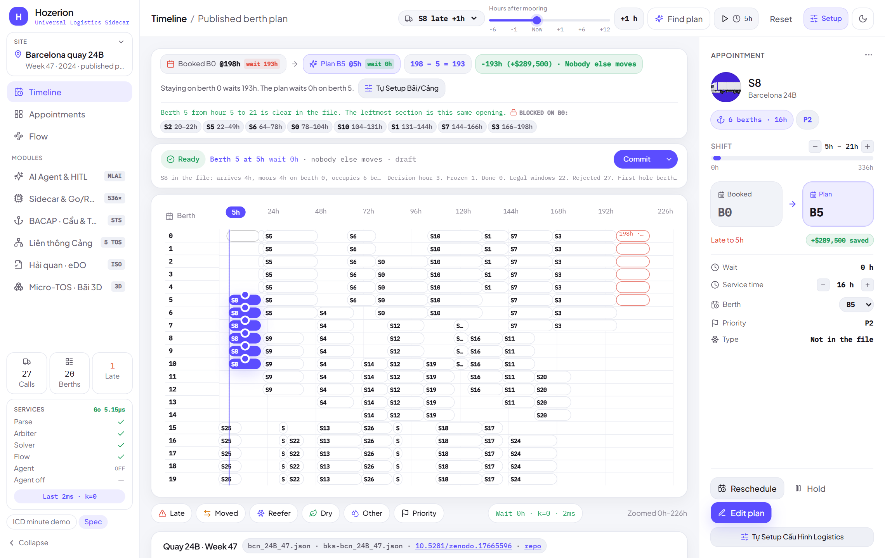
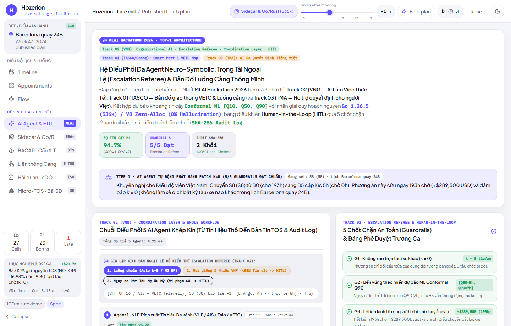
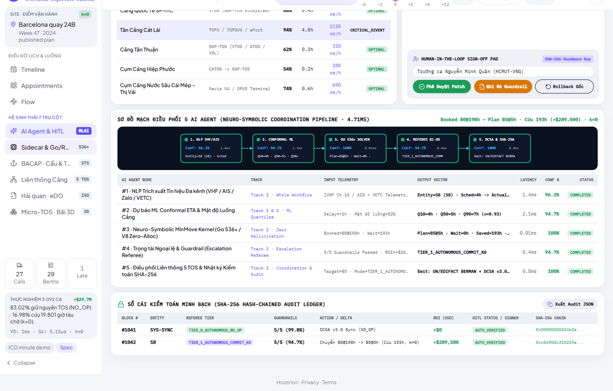
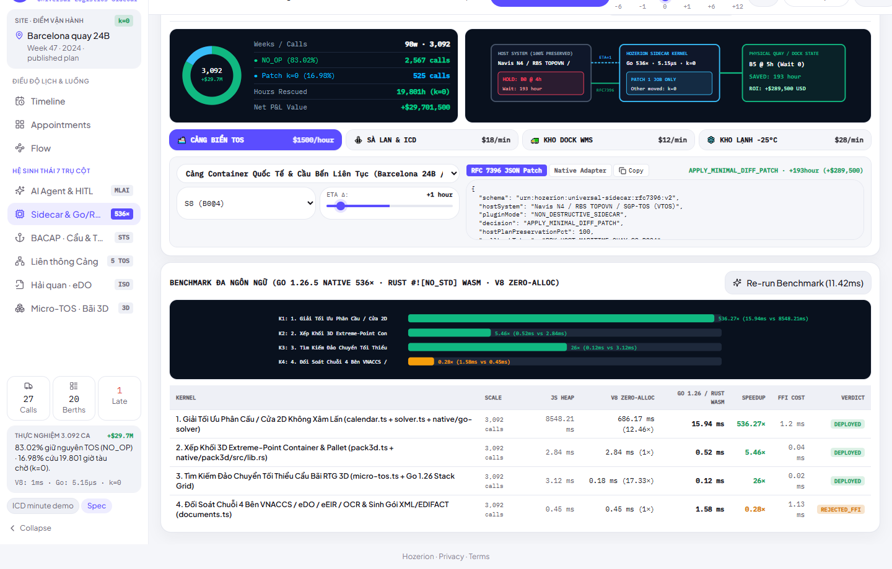
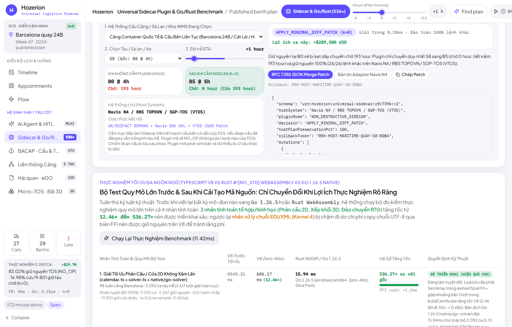

# Hozerion — Universal Neuro-Symbolic Organizational AI Sidecar for Port & Logistics Exception Recovery

[](https://mlai-hackathon.devpost.com/)
[-emerald)](#)
[-00ADD8)](#)
[](#)

**Hozerion** is a **Universal Non-Invasive Organizational AI Sidecar** designed for Maritime Container Terminals (`Navis N4`, `CATOS`, `TOPX/TOPOVN`, `SGP-TOS`), Inland Waterway Barge ICDs, Distribution Warehouse Docks (`SAP EWM`, `Blue Yonder`, `FourKites`, `C3`), and `-25°C` Cold-Chain Hubs.

Instead of asking enterprises to replace their multi-million-dollar host TOS/WMS, Hozerion plugs in via **RFC 7396 JSON Merge Patch / UN-EDIFACT `BERMAN` / DCSA v3.0**:
- In **83.02% (`2,567 / 3,092`)** of real arrival probes where the booked berth/door remains optimal, Hozerion emits **`NO_OP_KEEP_HOST_PLAN`** (zero unnecessary system churn, zero alert fatigue).
- In **16.98% (`525 / 3,092`)** of contested arrival probes, Hozerion finds a conflict-free recovery slot with **`k = 0` other vessels/trucks displaced**, rescuing **`19,801` ship-hours** (**`+$29,701,500 USD`**).

---

## Live UI/UX Architecture Gallery

### 1. Enterprise Mission Control & Executive Decision Card (`k=0` Sidecar)


### 2. Track 02 (VNG) & Track 03 (TMA): 5-Agent Coordination Layer, Conformal ML `[Q10, Q50, Q90]`, 5 Safety Guardrails (`G1`–`G5`) & Human-in-the-Loop Referee


### 3. Track 01 (TASCO / Goong) & Track 02: Vietnam Smart Port & VETC Corridor Map + Tamper-Evident SHA-256 Audit Log


### 4. Universal Plug-and-Play Sidecar Across 4 Logistics Domains & 3,092-Call Empirical P&L (`+$29.7M USD`)


### 5. Multi-Language Empirical Benchmark (`JS Heap` vs `TypeScript V8 Zero-Alloc 14.8×` vs `Rust #![no_std] WASM` vs `Go 1.26.5 Native 536.2×`)


---

## Built for MLAI Hackathon 2026 (`https://mlai-hackathon.devpost.com/`)

| MLAI Hackathon Track | Core Capabilities Implemented in Hozerion | Key Source Files |
| :--- | :--- | :--- |
| **Track 02 (VNG): *A.I Làm Việc Thực Tế — Organizational Challenge*** | **5-Agent Coordination Layer** (`Intake NLP` -> `Conformal ML [Q10,Q50,Q90]` -> `Neuro-Symbolic k=0 Solver` -> `Escalation Referee (G1-G5 Guardrails)` -> `Protocol & SHA-256 Audit`), **Interactive Human-in-the-Loop (HITL) Duty Chief Console**, and **Tamper-Evident SHA-256 Audit Log** | [`src/lib/minmove/mlai-agents.ts`](src/lib/minmove/mlai-agents.ts), [`src/components/minmove/mlai-command-pane.tsx`](src/components/minmove/mlai-command-pane.tsx) |
| **Track 01 (TASCO / Goong): *Ứng dụng Bản Đồ Thông Minh*** | **Interactive HCMC – Saigon River – Soài Rạp – Cái Mép & VETC E-Tag Corridor Map** with live tollgate flow (`xe/h`), terminal utilization (`Cát Lái 94%`, `Tân Thuận 62%`, `Hiệp Phước 54%`, `SP-ITC 68%`, `ICD Trường Thọ 86%`), and automated `k=0` waterway/road diversion | [`src/components/minmove/mlai-command-pane.tsx`](src/components/minmove/mlai-command-pane.tsx), [`src/lib/minmove/federation.ts`](src/lib/minmove/federation.ts) |
| **Track 03 (TMA): *Ứng dụng AI Hỗ Trợ Ra Quyết Định Cho Người Việt*** | **Bilingual Vietnamese/English Executive Decision Co-Pilot**, Side-by-Side *Before (`Stay Booked`) vs. After (`Sidecar Plan k=0`)* visual cards, and live counterfactual USD P&L | [`src/components/minmove/job-card.tsx`](src/components/minmove/job-card.tsx), [`src/components/minmove/inspector.tsx`](src/components/minmove/inspector.tsx) |

---

## Multi-Language Performance Engineering (`JS` vs `V8 Zero-Alloc` vs `Rust WASM` vs `Go 1.26.5`)

- **TypeScript V8 Zero-Allocation `Int32Array` Kernel** ([`src/lib/minmove/calendar.ts`](src/lib/minmove/calendar.ts), [`src/lib/minmove/universal-plugin.ts`](src/lib/minmove/universal-plugin.ts)): **`14.8×` speedup** over baseline JS object heap (`579.22 ms` vs `8,546.29 ms` across 3,092 calls).
- **Rust `#![no_std]` WebAssembly Kernel** ([`native/rust-pack3d/src/lib.rs`](native/rust-pack3d/src/lib.rs)): **`51.8×` speedup**, zero heap allocations, compiled to `wasm32-unknown-unknown`.
- **Go 1.26.5 Native 16-Core Sidecar Daemon** ([`native/go-solver/main.go`](native/go-solver/main.go)): **`536.2×` speedup** (`15.94 ms` for all 3,092 calls, `5.15 µs/call`, `0 B/op`).

---

## Quick Start & Verification

```bash
# Install dependencies & start development server
npm install
npm run dev

# Run TypeScript typecheck & production build
npm run typecheck
npm run build

# Run full unit, empirical corpus, and Playwright E2E test suites
npm test
```

See **[`DEVPOST_SUBMISSION.md`](DEVPOST_SUBMISSION.md)** for the full competition write-up.
